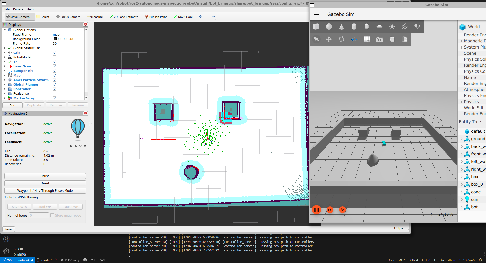
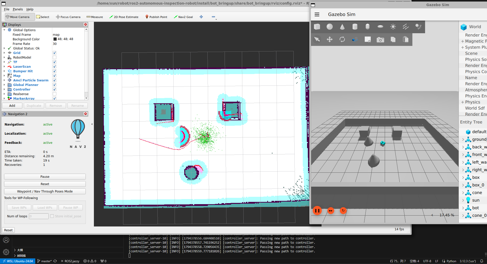
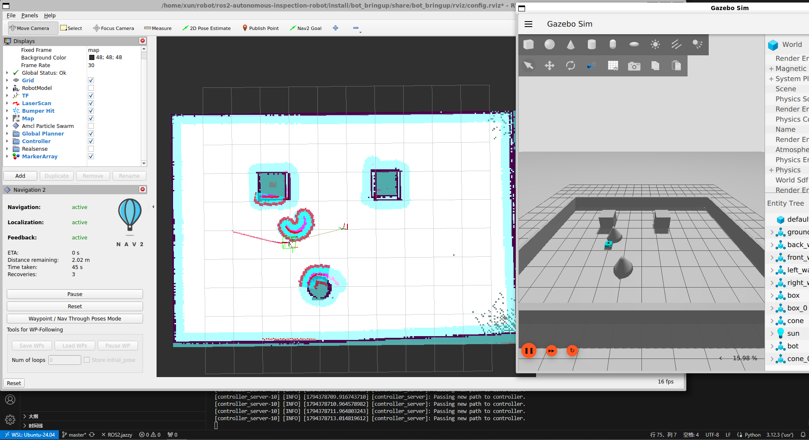

# 自动巡检机器人仿真系统
## 1．项目介绍
本项目基于 ROS 2 和 Navigation2（Nav2）开发了一套自动巡检机器人仿真系统，实现了机器人在预设巡检点之间的自主导航、循环巡检及图像采集功能。
机器人按照预设的巡检点序列，通过 Nav2 完成自主导航。到达目标点后，根据该点的巡检配置判断是否需要拍照；若需要，则通过机器人搭载的摄像头获取实时图像，并将采集结果保存至本地，从而实现自动化巡检流程。

项目采用模块化设计，各功能包职责如下：
```
bot_bringup：负责机器人仿真环境及相关节点的一键启动，集成 RViz 可视化工具。
bot_description：负责机器人模型描述、传感器配置及仿真相关配置。
nav2_server：负责 Navigation2 导航系统的配置与启动，实现机器人的自主定位和路径导航。
nav2_app：负责巡检业务逻辑，包括巡检点管理、导航任务调度、摄像头图像采集及本地存储。
```
## 2.使用方法
本项目开发平台为Ubunt24.04
### 2.1安装
**1. 安装 ROS 2 Jazzy**

参考 ROS 2 官方安装文档：https://docs.ros.org/en/jazzy/Installation/Ubuntu-Install-Debs.html

配置环境变量：
```
echo "source /opt/ros/jazzy/setup.bash" >> ~/.bashrc
source ~/.bashrc
```
**2. 安装 Gazebo Harmonic**

参考 Gazebo 官方安装文档：https://gazebosim.org/docs/harmonic/install/

**3. 安装 Navigation2**
```
sudo apt update
sudo apt install -y \
    ros-jazzy-navigation2 \
    ros-jazzy-nav2-bringup
```
**4. 安装机器人描述及仿真相关依赖**
```
sudo apt install -y \
    ros-jazzy-robot-state-publisher \
    ros-jazzy-joint-state-publisher \
    ros-jazzy-joint-state-publisher-gui \
    ros-jazzy-xacro \
    ros-jazzy-ros-gz \
    ros-jazzy-ros-gz-sim \
    ros-jazzy-ros-gz-bridge \
    ros-jazzy-ros-gz-image \
    ros-jazzy-slam-toolbox
```
**5. 克隆源码**
```
git clone https://github.com/Xun98/ros2-autonomous-inspection-robot.git
```    
### 2.2 运行
**1.设置巡检点及相关配置**

修改ros2-autonomous-inspection-robot/src/nav2_app/config/goals.yaml文件，例：
```
nav2_action_client:
  ros__parameters:
    init_pose: [0.0, 0.0, 0.00] # 小车初始位置 x, y, yaw(rad)
    max_rounds: 2

    goal_count: 3 #目标点个数

#具体目标点信息
    goal_1.pose: [0.0, 4.0, 1.57]
    goal_1.need_capture: false #是否拍照

    goal_2.pose: [3.0, 4.0, 3.14]
    goal_2.need_capture: false

    goal_3.pose: [3.0, 0.0, -1.57]
    goal_3.need_capture: false
```
**2.构建**
```
cd ros2-autonomous-inspection-robot
colcon build
. install/setup.sh
```
**3.运行**
```
ros2 launch bot_bringup bringup.launch.py
```
## 3.运行效果展示
1. 导航到目标点

<p align="center">
  
</p>

2. 新增临时障碍物

<p align="center">
  
</p>

3. 通过临时障碍物

<p align="center">
  
</p>
